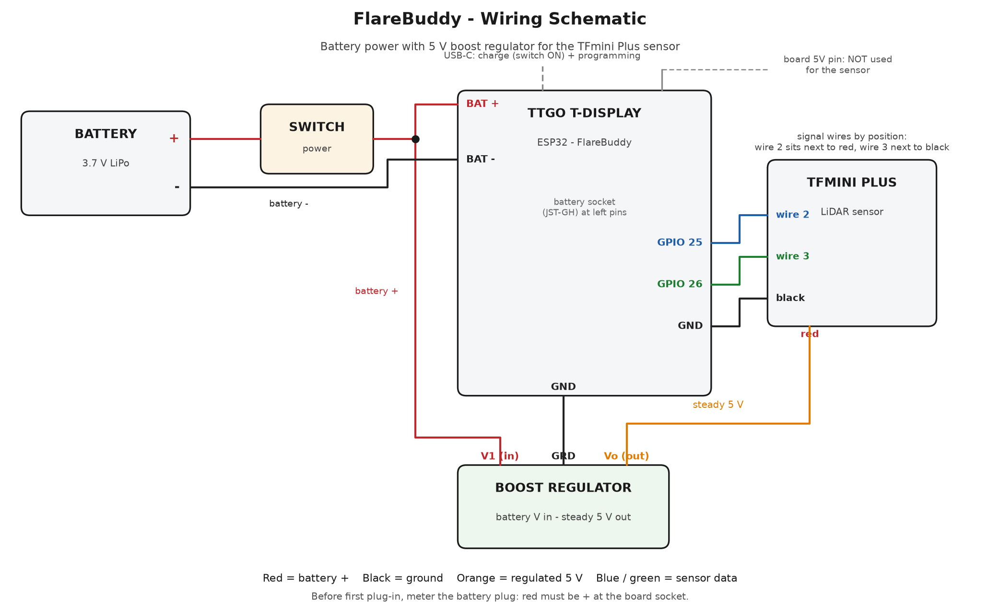

# FlareBuddy — HOWTO

Build, wire, flash, set up, and install the FlareBuddy landing height
caller. Read the [README](README.md) first for what it is and what it
isn't (an uncertified advisory aid — fly the airplane).

## 1. Parts

| Part | Notes |
|---|---|
| LilyGo TTGO T-Display, **16 MB**, classic ESP32 | The brain. Must be the **classic ESP32** version — Bluetooth Classic A2DP carries the audio. The T-Display-**S3** is a different board (BLE only) and **will not work**. USB chip may be CH340K or CH9102 depending on production run; both work, they just need different Windows drivers. |
| Benewake TFmini Plus LiDAR | 0.1–12 m, IP65, UART. The sensor the box is designed around. |
| LiPo battery, 3.7 V, 2000 mAh, **JST-GH 1.25** plug | The T-Display battery socket is JST-GH 1.25 mm — *not* the common JST-PH 2.0. **Check polarity with a meter before the first plug-in**: these plugs are wired both ways by different makers, and reversed polarity kills the board. |
| 5 V boost regulator board | Generic 3-pin style (pins marked **Vo / GRD / V1**) or a Pololu U1V11F5. Feeds the sensor a steady 5 V from the battery. |
| Slide switch, SPST | In the battery + lead. |
| 3D-printed box | ABS for cockpit heat. The reference build integrates a GoPro-pattern fork into the box. Board 51.4 × 25.2 mm; display glass 29.5 × 17.6 mm, offset 7.6 mm from the board's bottom (LILYGO) end. |
| Strut mount | FlightFlix / Rock Steady pattern cushioned strap mount with a ball or GoPro hinge for tilt. Plus a safety lanyard — always. |
| Bluetooth audio target | Galaxy Buds Pro (proven) or any A2DP earbuds/headset; or a direct-plug Bluetooth receiver (e.g. Scosche BTAXS3) in the audio panel's aux input. |
| Optional: [AJ-SR04M ultrasonic](https://probots.co.in/aj-sr04m-waterproof-ultrasonic-distance-sensor-module.html) + its blue driver board | Bench/backup sensor. The firmware's SENSOR menu supports it on the same pins. Its ladder tops out around 19 ft, so it's a fallback, not the flight sensor. (A commodity part — the same kit is on Amazon, eBay and AliExpress for roughly $10–15.) |

## 2. Wiring

Everything shares one small harness. The TFmini's factory cable is
30 cm and is **not cut** in the reference build — the slack coils
inside the box.



*The whole harness on one page: battery → switch → board, with the
boost regulator feeding the sensor its own steady 5 V. The text below
is the same wiring, spelled out.*

**Power**

```
Battery + ── slide switch ──┬── board battery socket (+)
                            └── regulator V1 (input)
Battery − ───────────────────── board battery socket (−)
Regulator GRD ───────────────── board GND
Regulator Vo ────────────────── sensor red wire ONLY
```

- Never connect the regulator's Vo to the board's 5V pin. That pin
  back-feeds raw battery voltage when USB is absent (measured 3.5 V on
  battery) and must not be tied to the regulated rail.
- Charge the battery over USB-C **with the slide switch ON** — the
  switch disconnects the battery from the charger too.
- Expect ≈5.26 V measured at Vo; the sensor's window is 4.5–5.5 V.

**Sensor (TFmini Plus → board)**

The sensor's UART is 3.3 V logic — wire it straight to the GPIOs, no
level shifting, no driver board.

| Sensor wire (by connector position) | Board |
|---|---|
| Red end of the connector (+5 V) | Regulator Vo |
| Next to red (sensor RX) | GPIO 25 |
| Next to black (sensor TX) | GPIO 26 |
| Black end (GND) | Board GND |

Wire *colours* vary between harnesses (the reference unit's middle
wires are white and green, not the datasheet's white and blue) — go by
**position in the connector**, red end and black end, as above.

**Ultrasonic (optional)** — probe's driver board: Trig → GPIO 25,
Echo → GPIO 26 through a 1 kΩ / 2 kΩ divider (the Echo line is 5 V),
board powered from 5 V. Same connector points, which is why the menu
can swap sensors in software.

## 3. Firmware

You need the Arduino IDE 2.x on a computer.

1. **ESP32 core: install 3.3.x** (3.3.13 is the verified build).
   Decline core 4.0.0 for now — its link step fails on Windows user
   paths containing a space (e.g. `C:\Users\First Last\…`).
2. **Board**: TTGO T-Display (or ESP32 Dev Module — set the flash to
   16 MB if your board is the 16 MB variant).
3. **Partition Scheme: "Huge APP (3MB No OTA/1MB SPIFFS)"** — required.
   The A2DP stack plus the voice clips (~0.9 MB) do not fit the
   default app partition.
4. **Libraries**:
   - **ESP32-A2DP 1.8.12** — install from the project's ZIP release if
     Library Manager search doesn't find it.
   - **Adafruit GFX Library** and **Adafruit ST7735 and ST7789
     Library** — from Library Manager.
5. Put `height_caller_v21.ino` and `voice_clips.h` in the **same
   sketch folder** (the folder must be named after the sketch for the
   IDE; one standing folder reused for every version keeps the IDE's
   remembered board/port/partition settings).
6. **Check Tools → Port immediately before uploading** — Windows
   renumbers these boards between COM ports when they're replugged.
7. Upload. Success looks like the board rebooting to a screen that
   says HEIGHT - FEET with a height reading (or dashes / NO RETURN
   with nothing in front of the sensor).

One-time driver note: a CH340K board needs the Silicon Labs CP210x /
WCH CH340 driver (depending on chip) before any COM port appears; a
charge-only USB cable will light the board's LED but never enumerate —
if there's no port at all, suspect the cable first.

## 4. First setup (on-device settings)

Hold **both front buttons for 2 s** to open SETTINGS. In every menu,
**VOL− steps to the next item, VOL+ chooses it**. Settings survive
power cycles and firmware updates.

- **BT DEVICE** — pair your audio target. Put earbuds in pairing mode
  first (Galaxy Buds Pro: buds in the case, close it, reopen it — the
  touchpad-hold method alone didn't work). Pick the device from the
  list; after the first successful connect the board remembers it and
  reconnects on its own at power-up.
- **WHEEL OFFSET** — the sensor's height above the ground with the
  airplane parked on its gear, 0.0–4.0 ft in 0.5 ft steps. Callouts
  report wheel height = sensor reading − offset. Use **0.0 for bench
  testing**; set the real value at install (section 6).
- **SENSOR** — TFMINI for flight. (ULTRASONIC only if the AJ-SR04M is
  wired up.) Both sensors land on the same two pins, GPIO 25/26,
  which is what makes a software swap possible — but they are very
  different instruments, compared honestly below.
- **DISPLAY** — UPRIGHT or FLIPPED, for boxes that mount the board
  USB-end down. The buttons swap sides to match, so VOL− stays on
  your left.
- **LADDER** — 20 FT (the original: every foot from 20) or FULL
  (40/35/30/25, then every foot from 20). Default is 20 FT.
- **DONE** — back to normal operation; Bluetooth starts and connects.

Volume: in normal operation the front buttons step the callout volume
(40/60/80/100/127) with a confirmation beep; the level is saved.

### The two sensors, honestly compared

| | AJ-SR04M ultrasonic | TFmini Plus LiDAR |
|---|---|---|
| Measures with | 40 kHz sound pulses | Infrared light (time of flight) |
| Range | 15.5 ft against a wall on the bench — but only ~10.5 ft over black asphalt and ~9 ft over damp ground | Rated 0.1–12 m (39.4 ft); read solidly to 37 ft on the bench, the limit of the test space |
| Beam | A wide cone (tens of degrees) — it hears the ground, the gear legs, anything in the cone | A narrow spot, about 3.5° — it measures the patch of ground it's actually pointed at |
| Accuracy/stability | Wanders with air temperature (the speed of sound moves) and surface; soft ground absorbs the echo | ±5 cm to 6 m, and every reading carries a signal-strength value the firmware can reject on |
| Interface | Trigger/echo pulses; the echo line is 5 V, so GPIO 26 needs a 1 kΩ / 2 kΩ divider | UART straight into GPIO 25/26 at 3.3 V — no divider, no driver board |
| Construction | Waterproof probe on a 2.5 m cable, plus a separate driver board that is *not* waterproof | One sealed IP65 unit, 12 g |
| Price | ~$10–15 | ~$52 |

**Why the LiDAR is the flight sensor.** Range, mostly: the
ultrasonic gives up over real ground at about 10 ft — exactly where
flare callouts matter most — while the LiDAR covers the whole
descent, which is what makes the Full Range ladder possible at all.
Its narrow spot also means fewer phantom readings off gear legs and
struts, and its numbers are steadier, so the callouts track the
descent crisply instead of lagging behind the median filter. The
ultrasonic earned its place — it was the prototype's first sensor,
it's nearly free, and the probe itself is waterproof — but it is a
bench and backup sensor. Fly the LiDAR.

## 5. Bench test

1. Sensor = TFMINI, offset = 0.0, ladder = FULL.
2. Connect the earbuds and confirm the speaker icon appears on the BT
   line — that icon means audio is *actually flowing*, which can lag
   "BT: CONNECTED" by a few seconds. The current height is announced
   once when audio goes live.
3. Walk the unit (or a target board) down from past 40 ft: expect
   **40, 35, 30, 25, 20, 19, 18…** each called as you descend through
   its number. Back up and it counts up again.
4. Two behaviours that are the design working, not faults:
   - After a fast move to a new height there's a **~¾ second pause**
     before it's announced — the plausibility gate confirming the step
     was real (see the README).
   - On USB power the bottom line reads **USB POWER** instead of a
     battery percentage.
5. Range expectations: rock-solid readings to ~37 ft were measured on
   the prototype (through the lens film). The sensor is rated to
   39.4 ft; treat anything beyond as best-effort.

## 6. Installation

1. **Peel the protective film off the sensor's lens windows before
   flight.** The manual is blunt: anything transparent in front of
   the windows makes the sensor misread. (Leaving the film on during
   the build is good practice — the windows are acrylic and scratch
   easily.)
2. Mount the box so the sensor points **straight down in flight
   attitude** — either level the airplane (tail up) while you set the
   tilt, or offset by the parked deck angle and mark the mount with
   index lines so a reinstall lands in the same place. A few degrees
   of tilt costs almost nothing (~0.4% at 10 ft); a big angle costs
   real height.
3. **Safety lanyard**, always. Check door swing and gear clearance at
   the strut root.
4. Measure the parked sensor-to-ground distance and set it as the
   **WHEEL OFFSET**. If your installation puts the sensor more than
   4 ft up parked, the offset list tops out at 4.0 — extend
   `OFFSET_VALUES` in the sketch and rebuild.
5. First flight: calm day, a runway you know, and treat the callouts
   as a second opinion while you learn how its numbers feel against
   your own picture.

## 7. Sensor care

- The lens windows are **acrylic IR-pass filters**. **Never clean
  them with alcohol** (it damages acrylic). Air blower or a clean
  microfiber, water-damp at most. Keep them dust-free — a dirty
  window is the top cause of bad readings.
- No covers, caps, or clear guards in front of the lens in flight.

## 8. Troubleshooting

| Symptom | Likely cause |
|---|---|
| No COM port at all | Charge-only USB cable, or the USB-serial driver isn't installed. |
| Earbuds won't pair | They aren't in pairing mode — for Galaxy Buds Pro, buds in case, close, reopen. |
| "BT: CONNECTED" but no callouts | Audio isn't flowing yet (watch for the speaker icon), or you're above the ladder's zone / outside sensor range. |
| No callouts above ~19 ft on the ultrasonic | Expected — that's its ceiling. The TFmini is the flight sensor. |
| Wild height announced once, then quiet | A bad reflection got through for a moment; the plausibility gate and watchdog handle it. Repeated wild readings = check for a dirty lens or something in the sensor's view. |
| Screen upside down | SETTINGS → DISPLAY → FLIPPED. |
| Battery shows 100% forever on USB | You're reading an old firmware — v21 shows USB POWER. On battery the percentage is a voltage estimate, not a fuel gauge. |
| Sketch too big / upload fails at link | Partition scheme isn't Huge APP, or the ESP32 core is 4.0.0 on a spaced Windows path. |

## 9. Voice clips

The callouts are synthesized speech, baked in as PCM arrays in
`voice_clips.h` (44100 Hz mono 16-bit, trimmed at 3% of peak,
peak-normalized). To regenerate or change a word: synthesize the word
as an MP3 in the same voice, drop it in `voice/` next to the others,
and run `voice/make_clips_v20.py` — it rebuilds the header. The
existing 1–20 clips are sample-identical across every regeneration
since v17, so a rebuild only changes what you changed.
