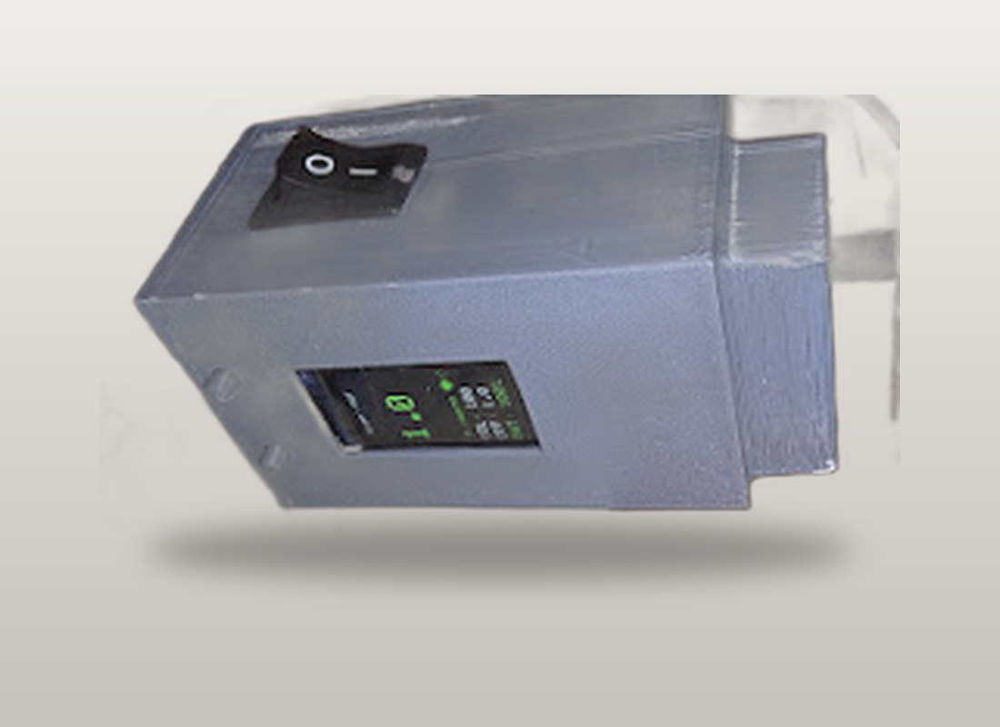
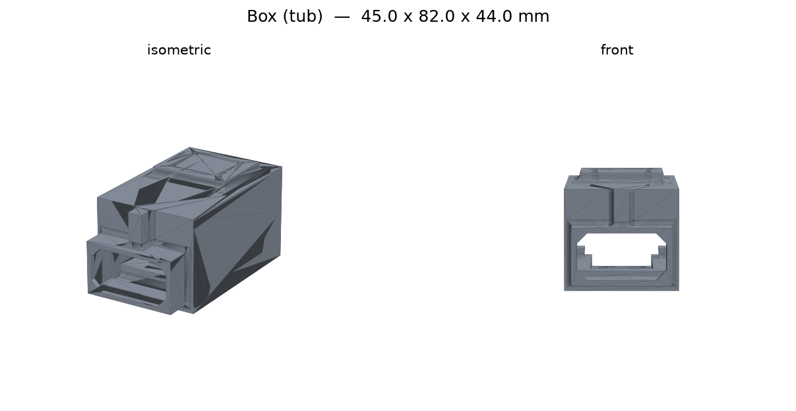
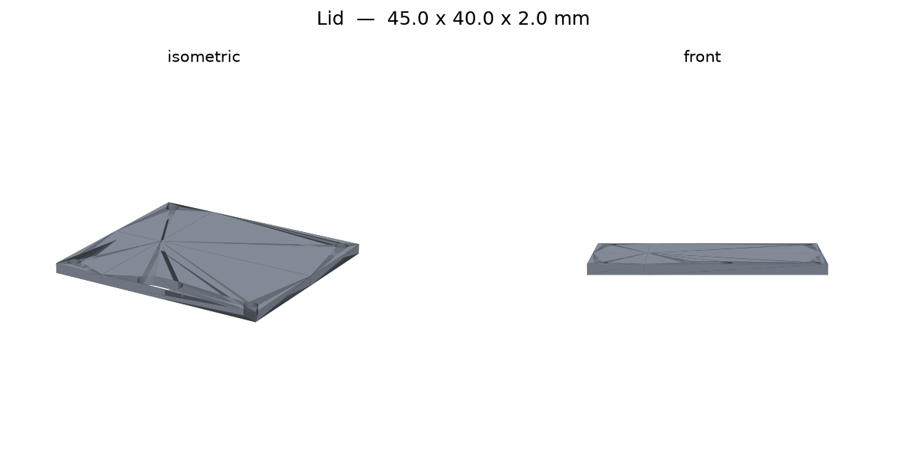
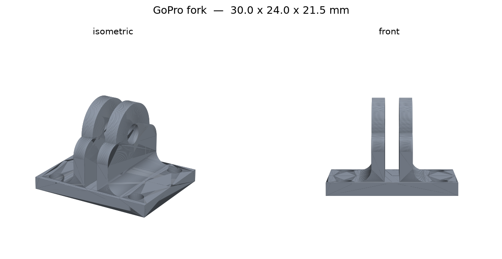
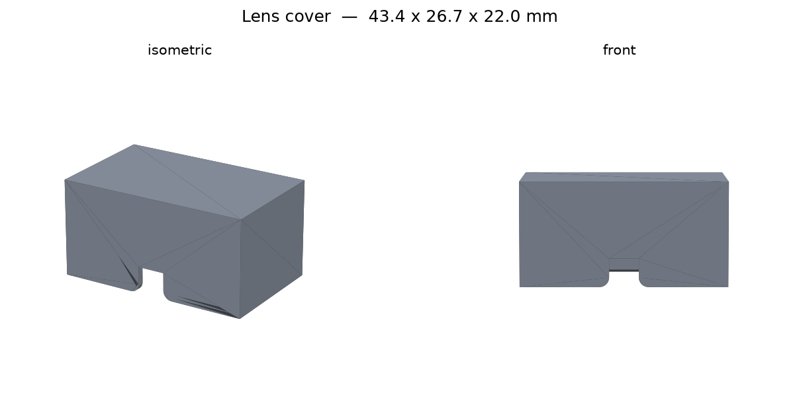
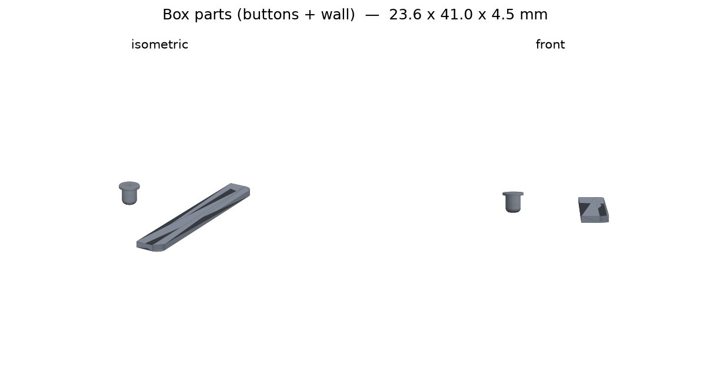

# FlareBuddy hardware — box and mount files

Printable and editable files for the FlareBuddy enclosure, designed by
Mark Harris in Onshape and printed in ABS.

 

*Left: the front of the box is the business end — the TFmini Plus looks
out of the black sensor face (the protective film comes off before
flight), the power slide switch sits on top, and the GoPro-pattern
fork is at the back. Right: the display side, with a live height
reading on the T-Display screen.*

## Renders

Two views of each printed part, rendered from the STLs in this folder.

**Box (tub)** — 45.0 × 82.0 × 44.0 mm

**Lid** — 45.0 × 40.0 × 2.0 mm

**GoPro fork** — 30.0 × 24.0 × 21.5 mm

**Lens cover** — 43.4 × 26.7 × 22.0 mm. Slips over the sensor face to
protect the acrylic lens windows in storage and transit. **Remove
before flight** — the sensor cannot see through anything, including a
clear cover.

**Box parts (buttons + wall, as one plate)** — 23.6 × 41.0 × 4.5 mm

**Push buttons** — 4.8 × 4.8 × 4.5 mm each, print two

**Wall insert** — 6.0 × 41.0 × 1.4 mm

## Files

Each part is here as an **STL** (print-ready) and a **STEP** (editable
solid — mesh formats import into CAD tools like Onshape only as dead
references; STEP imports as a real solid).

| Part | STL | STEP |
|---|---|---|
| Box (tub) | Box.stl | Box.step |
| Lid | Lid.stl | Lid.step |
| GoPro fork | Gopro Fork.stl | Gopro_fork.step |
| Lens cover | Lens Cover.stl | Lens Cover.step |
| Box parts plate | Box Parts.stl | Box Parts.step |
| Push buttons ×2 | Box Parts - Buttonx2.stl | (in Box Parts.step) |
| Wall insert | Box Parts - Wall.stl | (in Box Parts.step) |

## Build

### Parts

The electronics that go in the box. (The printed parts are the files
in the table above.)

1. **Controller — LilyGo TTGO T-Display, 16 MB — ~$9.** The brain: classic
   ESP32 with a 1.14″ colour display and two front buttons. It *must*
   be the classic-ESP32 board — its Bluetooth Classic A2DP is what
   streams the spoken callouts, and the 16 MB flash is needed for the
   firmware's partition scheme. The T-Display-S3 looks similar and
   will not work (BLE only). Choose the 16 MB option.
   [LilyGo T-Display](https://lilygo.cc/products/t-display?bg_ref=7LJo9u5wwo&variant=42159376433333)

2. **Battery — 3.7 V, 2000 mAh LiPo, JST 1.25 plug — ~$12.** A single-cell
   pouch pack with a protection board, sized to stack behind the
   T-Display. The board's battery socket is **JST-GH 1.25 mm** — not
   the common JST-PH 2.0 — so buy the pack with the 1.25 plug already
   fitted. **Meter the polarity before the first plug-in**: these
   plugs are wired both ways by different makers, and reversed
   polarity kills the board.
   [Example pack with the 1.25 plug](https://www.amazon.com/dp/B0F37YXH7W)

3. **Power switch — mini rocker switch, SPST, snap-in panel mount,
   19.2 × 13 mm cutout class (KCD1) — ~$2.50.** Sits in the battery's positive
   lead on top of the box; it disconnects the battery from
   everything, charger included, so charging happens over USB with
   the switch ON. The opening in the printed box measures
   20.0 × 12.8 mm, which is this standard mini-rocker cutout — do
   not substitute the slim 19 × 6.5 mm rockers, they fall through.
   [TE Connectivity PRASA1-16F-BB000 at Newark](https://www.newark.com/alcoswitch-te-connectivity/prasa1-16f-bb000/switch-rocker-spst-16a-250v-black/dp/89C8962?CMP=AFC-ECIA)

4. **Sensor — Benewake TFmini Plus LiDAR — ~$52.** The eyes: 0.1–12 m range,
   ±5 cm to 6 m, IP65, UART output, 12 g. It mounts at the end of the
   box with its windows flush in the sensor face.
   [Benewake TFmini Plus at GetFPV](https://www.getfpv.com/benewake-tfmini-plus-ip65-lidar.html)

5. **Voltage regulator — 5 V boost (step-up) board — ~$9.** The sensor
   needs a steady 5 V (its window is 4.5–5.5 V) whatever the battery
   is doing, and the board's own 5V pin only back-feeds raw battery
   voltage (~3.5 V) when USB is absent — so the sensor gets its own
   regulated rail. The reference build uses a generic 3-pin boost
   board (pins marked Vo / GRD / V1; measured 5.26 V out). The Pololu
   U1V11F5 is a known-good equivalent: battery to VIN, VOUT to the
   sensor, GND common.
   [Pololu U1V11F5 at RobotShop](https://www.robotshop.com/products/pololu-5v-step-up-voltage-regulator-u1v11f5)

**Total for the electronics: ≈ $85** (prices as of November 2026,
before shipping and tax). Add a few dollars of filament for the
printed parts plus the M5 and M3 hardware, and the unit itself lands
**under $100**. The strut mount is separate — the cushioned GoPro
strut mount runs about $99 new.

### Assembly

Print the parts from the STL files provided (STEP files are provided
if you want to edit the design). You will need the box, the lid, the
GoPro fork, two buttons, and the wall (the narrow, long piece).

Wire up the electronics and verify operation on the bench first (see
HOWTO.md for specifics). **Tip:** put a JST connector in the harness
between the power switch and the micro-controller — it makes
installing the power switch from outside the case possible.

First, install the LiDAR sensor in the end of the box so it seats
fully in its pocket. Mind the routing of the sensor's harness: there
is a pocket that accepts the harness without putting undue stress on
it, so the sensor can only be installed in one orientation.

Next, install the micro-controller in its pocket with the display
facing outward through the cutout window. The end with the Wi-Fi
antenna fits into a pocket toward the sensor end. Pack a little foam
rubber around that end of the controller to take up the excess space —
it keeps the end from moving or vibrating in the pocket.

Install the two push buttons in their holes before seating the
controller all the way down. The large end of each push button sits
inside the case, very close to the board's buttons but **not putting
pressure on them. This is important** — a plunger resting on a button
holds that button down.

At this point, take the wall (the thin strap piece) and slide it into
the slots at the front of the case opening. This captures the
micro-controller in its slot so it can't move when the push buttons
are pressed.

Place the battery in the pocket opposite the micro-controller and use
hot glue (or similar) to hold it in position.

Roll the rest of the wiring, along with the voltage regulator board,
into the center of the case between the micro-controller and the
battery. **Be sure no exposed wire can possibly short out against the
micro-controller.** Also be sure the mating connector for the switch
is still accessible at this point.

Install the power switch from the outside of the case, then connect
it to the harness just discussed.

Test the unit by plugging the USB back in and giving the display a
moment to light up. It should show 'USB POWER' at the bottom. Then
disconnect the USB and turn the switch on — now running on battery
power — and the display will show 'BAT: XX%'.

_**Important — charging:** USB will power up the micro-controller
with the power switch OFF, but **the battery only charges with the
switch ON** and the USB connected. Switch off + USB plugged in =
no charge._

At this point the software should already be set up, but if it isn't,
hold both push buttons for 2 seconds and the menu will be displayed.
The Bluetooth setting scans for available targets and displays what
it finds. Select the one you want; after a moment the unit returns to
the main screen showing 'Searching'. Once the desired BT device has
been found it will show Connected. Audio takes a few more seconds to
be established, and is shown by the speaker icon appearing on the
display — wait for the icon, not just the Connected message.

Test the audio on the selected device, using a target to check the
callouts at different distances. The left and right push buttons act
as volume down and up, and the display shows the current level as
'VOL: 100'.

Decide how best to mount the unit on the plane. It's suggested that a
camera mount be used, for flexibility of aiming; a strut-style camera
mount at the lowest point on the plane works best. Once the location
has been settled, aim the sensor at an angle approximating straight
down relative to the normal angle of attack (AOA) on short approach.
In a tailwheel airplane, for instance, with the plane settled on the
ground on all three tires, aim the sensor straight down — that will
be very close to the proper angle. Then measure the distance from the
floor to the lens of the sensor and enter it in the menu (hold both
buttons for 2 seconds) under the **WHEEL OFFSET** item, choosing the
value closest to your measurement. That gives an accurate height of
the tires above the ground for the audible callouts.

Finally, test-fly to verify proper operation. The last callout before
you feel the tires touch should be 'One'. If you don't hear 'One'
before touchdown, adjust the WHEEL OFFSET setting appropriately.

**Keep in mind that this device is experimental and for information
only.**

## Print notes (reference build)

- Material: **ABS** is the best choice, for its strength and
  temperature rating. PETG is the next choice. PLA can be used for
  test prints, but its low temperature rating means it could easily
  sag or melt in the hot sun.
- The GoPro hinge bolt is **M5** (an M5 × 25 mm bolt with an acorn or
  nyloc nut works); lid screws are **M3 × 6** into self-threaded
  bosses (model the pilot at Ø2.6 mm for printed ABS; M3 clearance is
  Ø3.2–3.4 mm).
- The sensor face sits at the end of the box — nothing, not even
  a clear cover, may sit in front of the LiDAR windows in flight.
  **Do** use the printed protective cover whenever the unit is off
  the airplane.
