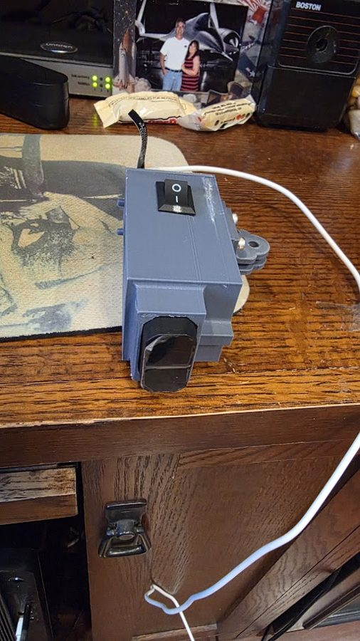
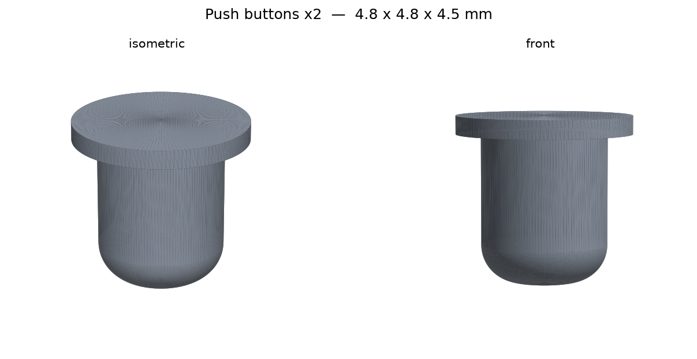
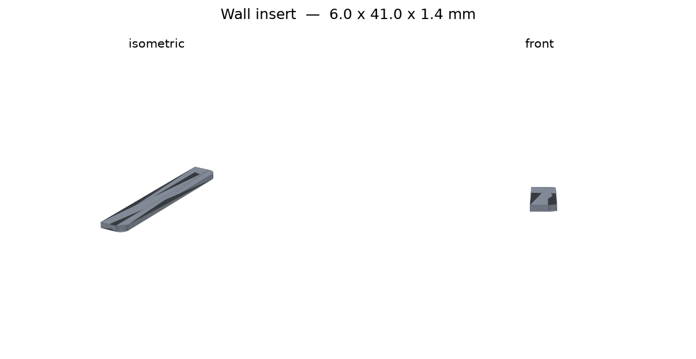

# FlareBuddy hardware — box and mount files

Printable and editable files for the FlareBuddy enclosure, designed by
Mark Harris in Onshape and printed in ABS.

*The front of the box is the business end: the TFmini Plus looks out of
the black sensor face (the protective film comes off before flight),
and the power slide switch sits on top. The GoPro-pattern fork is at
the back.*

## Renders

Two views of each printed part, rendered from the STLs in this folder.

**Box (tub)** — 45.0 × 82.0 × 44.0 mm

**Lid** — 45.0 × 40.0 × 2.0 mm

**GoPro fork** — 30.0 × 24.0 × 21.5 mm

**Lens cover** — 43.4 × 26.7 × 22.0 mm. Slips over the sensor face to
protect the acrylic lens windows in storage and transit. **Remove
before flight** — the sensor cannot see through anything, including a
clear cover.

**Box parts (buttons + wall, as one plate)** — 23.6 × 41.0 × 4.5 mm

**Push buttons** — 4.8 × 4.8 × 4.5 mm each, print two

**Wall insert** — 6.0 × 41.0 × 1.4 mm

## Files

Each part is here as an **STL** (print-ready) and a **STEP** (editable
solid — mesh formats import into CAD tools like Onshape only as dead
references; STEP imports as a real solid).

| Part | STL | STEP |
|---|---|---|
| Box (tub) | Box.stl | Box.step |
| Lid | Lid.stl | Lid.step |
| GoPro fork | Gopro Fork.stl | Gopro_fork.step |
| Lens cover | Lens Cover.stl | Lens Cover.step |
| Box parts plate | Box Parts.stl | Box Parts.step |
| Push buttons ×2 | Box Parts - Buttonx2.stl | (in Box Parts.step) |
| Wall insert | Box Parts - Wall.stl | (in Box Parts.step) |

## Print notes (reference build)

- Material: **ABS** (cockpit heat rules out PLA).
- The GoPro hinge bolt is **M5** (an M5 × 25 mm bolt with an acorn or
  nyloc nut works); lid screws are **M3 × 10** into self-threaded
  bosses (model the pilot at Ø2.6 mm for printed ABS; M3 clearance is
  Ø3.2–3.4 mm).
- The sensor face sits flush at the end of the box — nothing, not even
  a clear cover, may sit in front of the LiDAR windows in flight.
